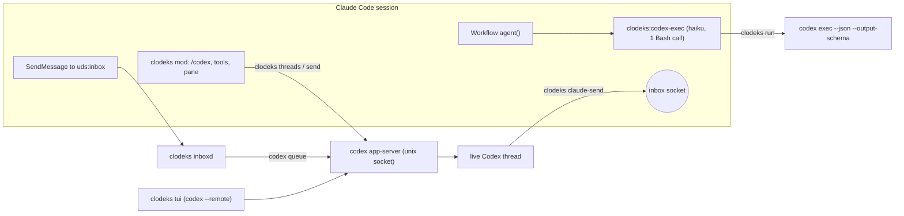

# clodeKs

clodeKs connects Claude Code and the OpenAI Codex CLI on one machine.

- **Codex as subagents.** A Claude Code Workflow fans out `clodeks:codex-exec` agents. Each one runs a Codex turn and returns schema-checked JSON.
- **A Claude mod.** The `clodeks` plugin adds `/codex`, `codex_threads`, `codex_pending`, `codex_jobs`, `codex_quota`, `codex_send`, and a clodeKs panel for service status.
- **Codex threads as message peers.** A Claude session messages a live Codex thread with `SendMessage`, and Codex replies with `clodeks claude-send`. Both sides use Claude Code's cross-session message format.

Tested on Claude Code 2.1.295 and codex-cli 0.154.0, Arch Linux.

## How it works



| Path | Mechanism | Contract |
|---|---|---|
| Claude to Codex subagent | `codex exec --json --output-schema -o` | Documented Codex CLI |
| Claude to a live Codex thread | Queue and steer APIs, or `codex queue --remote unix://...` | Pinned Codex app-server and CLI |
| Thread listing | app-server JSON-RPC (`thread/loaded/list`, `thread/list`) over WebSocket on a Unix socket | Codex app-server, marked experimental |
| Codex to Claude | One NDJSON frame on the session inbox socket | Socket and auth line documented. Frame and envelope read from the Claude Code bundle, so an update can break them |
| Claude reply to Codex | `codex_send` or `clodeks send` with the resolved thread ID | Direct app-server route, independent of inbox exposure |

clodeKs reads the Claude session registry. It never writes it, so Codex threads do not appear in `ListAgents`. The `codex_threads` tool fills that gap: it lists each thread with its inbox address.

## Install

Requirements: Node 22 or newer, `codex` logged in, Claude Code 2.1.224 or newer.

```bash
./install.sh                     # CLI link, env file, systemd unit links
./install.sh --enable-services   # also start the shared app-server and the inboxes
./install.sh --codex-skill       # also give Codex the claude-peer skill
./install.sh --claude-mod        # also link the plugin into ~/.local/share/claude-code-mods/clodeks
clodeks status
```

Load the Claude plugin for one session:

```bash
claude --plugin-dir /path/to/clodeKs/plugin
```

Or install it from this repository:

```bash
claude plugin marketplace add /path/to/clodeKs
claude plugin install clodeks@clodeks
```

After a plugin source update, run `/reload-plugins` directly in each affected Claude parent session.
Check the reload summary for agents and load errors, then launch a new `clodeks:codex-exec` subagent.
Claude caches parsed agent definitions. A new subagent can reuse the older definition until the parent reloads plugins.
Existing subagents keep their current prompts. A new Claude session also loads the current plugin source.
See the [Claude plugin loading reference](https://code.claude.com/docs/en/plugins/loading.md#check-which-stage-a-plugin-reached).

With `./install.sh --claude-mod`, the plugin link points to this checkout's `plugin` directory.
`CLAUDE_CODE_PLUGIN_DIRS` selects that link, and `plugin/agents/codex-exec.md` supplies the agent definition.
A marketplace install uses its installed copy. Update that copy before you reload the parent session.

## Use

Every wrapper subcommand accepts `-h` and `--help` to print its options before command effects.
For example, `clodeks tui --help` lists wrapper TUI options without connecting to the app-server.
Use `clodeks tui -- --help` for native Codex help. Arguments after that separator stay native arguments.
A help-looking option value, such as `--message=--help`, stays data.

### Codex subagents in a Workflow

```js
const r = await agent(
  `TASK: Review src/auth.ts for injection bugs.\nSCHEMA: {"type":"object","properties":{"findings":{"type":"array","items":{"type":"string"}}},"required":["findings"],"additionalProperties":false}\nCWD: ${repo}`,
  { agentType: 'clodeks:codex-exec', model: 'haiku', schema: RESULT },
)
// r = { ok, thread_id, result: { findings: [...] }, text, error }
```

`result` holds the parsed object under a schema, and the answer text without one. A stopped run can retain a partial result with `result_partial: true`.

`examples/workflow-fanout.js` is a complete script. A failed Codex run comes back as `ok: false` with `error`. It never throws and never returns an empty string.

To forward a complete brief file, give the agent `TASK_FILE: /absolute/path/to/brief.md` and ask it to use the file contents as task text.
The agent redirects that file into `clodeks run` stdin in its one Bash call. It keeps schema input on descriptor 3 when needed.
The file contents stay unchanged after any clodeKs context note. No shell expansion or heredoc marker applies to the task file.
Do not add separate task instructions outside the file. Supply one complete brief or use an inline TASK instead.

### One Codex turn from a shell

```bash
clodeks run --schema schemas/answer.json --cwd ~/repo <<'EOF'
What does this repository build?
EOF
clodeks run --resume <thread_id> --prompt 'And how is it tested?'
```

`clodeks run` defaults to the `read-only` sandbox, `approval_policy="never"`, and `features.hooks=false`. The last one keeps your own Codex hooks from running once per subagent. Pass `--write` for `workspace-write` and `--hooks` to keep your hooks.

Use `--loopback-isolated` when a test needs a local listener:

```bash
clodeks run --write --loopback-isolated --prompt 'Run the socket regression tests'
```

This opt-in mode gives each shell command a private network namespace. A test can bind and connect on `127.0.0.1` inside it.
Host loopback listeners, host Unix sockets, and external destinations remain unreachable. The proxy also denies external CONNECT requests.
Binds on `0.0.0.0`, `127.0.0.2`, and `::1` also work inside the namespace and stay private.
Keep each test server and its clients in the same command process tree. Separate tool commands get separate namespaces.
The flag changes no filesystem write scope or approval setting. Without it, socket behavior stays unchanged.

This mode currently supports Linux and Codex 0.169.0 only. It rejects `danger-full-access` and any managed requirements before model execution.
A private, no-model server checks requirements and filesystem settings with the same workspace and permission settings. Unknown checks stop the run.
The check runs before any `--git` fetch. Local Git metadata reads supply the complete permission roots first.
The mode rejects custom `sandbox_workspace_write.writable_roots`, `exclude_slash_tmp`, and `exclude_tmpdir_env_var` settings before model execution.
Use explicit `--add-dir`, `--git`, and `--relay` roots with the default workspace filesystem settings.
The checks retain managed policy and reject requirements that could change the requested network profile.
The preflight cannot freeze policy changes between the check and execution. Keep managed configuration stable for the run.
The mode writes no configuration files and never sets `network_access=true`.

Run the installed-backend boundary probe without a model:

```bash
nice -n 19 node --test --test-concurrency=1 test/native-loopback-probe.mjs
```

It checks public TCP egress, host TCP and Unix listeners, local data exchange, proxy denials, and unchanged default socket behavior.
It also checks filesystem roots under read-only permissions and native `exec resume` with a new isolated profile.
The resume check uses fixed local Responses events. It contacts no model service. The standalone sandbox check verifies proxy denials.

Use repeatable `--network-host HOST` options for package downloads from named public hosts:

```bash
clodeks run --write --network-host pypi.org --network-host files.pythonhosted.org --prompt 'Build the package'
```

Each option accepts one exact DNS host name. Names use ASCII labels, including explicit Punycode when needed.
clodeKs normalizes case and removes duplicate entries. It rejects URLs, ports, wildcards, IP literals, local names, and malformed labels.
The limit is 64 supplied host options. A redirect needs its destination in the list too.
Allowed hosts may receive traffic on any port and with any HTTP method.
List only read-only package indexes and artifact hosts. Never list hosts that accept writes, including `github.com` or upload endpoints.
A worker can send readable data to an allowed host. Choose the list before you start the run.

This mode requires Linux, Codex 0.169.0, default workspace filesystem settings, and no managed requirements.
Verification failures stop the run. There is no permissive fallback. `--loopback-isolated` and `danger-full-access` cannot combine with this mode.
Each run selects a fresh named permission profile, including resumed runs. Read-only repository scope and private temporary writes remain intact.
The managed proxy permits only the exact host entries. The namespace blocks direct egress when a client ignores proxy settings.
Private addresses, host loopback, Unix sockets, SOCKS, UDP, and upstream proxies remain disabled.
The preflight cannot freeze configuration changes. Keep managed configuration stable throughout the run.

The network profile denies access to these credential paths under the process home and the caller home:
`~/.ssh`, `~/.gnupg`, `~/.codex/auth.json`, `~/.config/gh`, `~/.config/act-secrets`, `~/.netrc`, `~/.npmrc`,
`~/.pypirc`, `~/.docker/config.json`, `~/.aws`, `~/.kube`, and `~/.git-credentials`.
It also denies `auth.json` under an explicit `CODEX_HOME`. The host Codex process retains its authentication access outside the sandbox.
This list covers known paths. Other readable files and inherited environment values can still contain private data.
Codex 0.169.0 can refuse a minimal HOME under writable temporary roots. Missing credential-path parents can stop sandbox startup.
clodeKs preserves the denial and returns the sandbox error. It does not create home directories or select a wider policy.

The result includes `network.allowed_hosts`, `network.audit_scope: "admission"`, `network.requests`, `network.truncated`, and `network.complete: false`.
Admission records describe proxy connection decisions. Several HTTPS application requests can share one connection.
Each collected record contains only `host`, `port`, `decision`, `reason`, and `time`.

Codex 0.169.0 emits native policy audits through tracing and OTEL. Its exec JSONL schema exposes no admission event.
clodeKs enables `codex_otel.network_proxy=info` through `RUST_LOG` and parses the native exec stderr diagnostics.
It preserves the caller's other log directives. It excludes raw audit metadata from ordinary failure diagnostics.

The collector accepts at most 1,000 records and 8,192 characters per diagnostic line. It discards malformed or oversized audit lines.
`network.truncated` becomes true when the line limit or record limit discards data.
The parser requires a tracing timestamp, INFO level, and the exact audit target at the start of the line.
Missing valid events produce `requests: null`, which marks unavailable admission evidence.

Tracing gives no delivery acknowledgement. Every result reports `complete: false`, including successful, failed, and timed-out runs.
Treat every record as untrusted, best effort evidence. A matching text prefix does not authenticate its source. Missing, malformed, or truncated records cannot make the result claim completeness.
See the pinned [native audit emitter](https://github.com/openai/codex/blob/rust-v0.169.0/codex-rs/network-proxy/src/network_policy.rs#L284),
[exec stderr subscriber](https://github.com/openai/codex/blob/rust-v0.169.0/codex-rs/exec/src/lib.rs#L355),
and [exec event schema](https://github.com/openai/codex/blob/rust-v0.169.0/codex-rs/exec/src/exec_events.rs).
Strict audit storage and per-request HTTPS inspection remain later design work.

Run the installed-backend release checks without a model service:

```bash
nice -n 19 node --test --test-concurrency=1 test/native-network-host-probe.mjs
```

These checks make public, read-only requests to PyPI and httpbingo.org. They require working host DNS, outbound HTTPS, Python, and curl.
They prove host-side connectivity before checking denied direct egress in the namespace.
They also check proxy 403 refusals for unlisted, private, and local destinations, redirects, and a resumed exec profile.
A synthetic `.netrc` file proves credential-read denial. These checks read no real credential content.

Read-only runs receive a private temporary folder outside the repository. The repository stays read-only.
`TMPDIR`, `TEMP`, and `TMP` point to that folder. `TMPPREFIX` places Zsh heredoc files there too.
Only that folder receives write access. The wrapper result, schema, and relay files stay outside that grant.
clodeKs removes the folder after the run, including a failed or timed-out run.
New and resumed runs receive the same scope. `--loopback-isolated` keeps its network boundary and grants the same temporary writes.
The temporary grant requires tested Codex 0.169.0 and no managed requirements.
clodeKs checks both before it selects the named profile. If either check fails, it keeps the original read-only policy without temporary writes.
The prompt and result field `temp_folder_unavailable` report the reason. The run never selects a wider policy to obtain temporary storage.
Temporary storage needs the bubblewrap backend on Linux. clodeKs forces the legacy Landlock backend off for this profile.
If bubblewrap is unavailable, enable it before using this temporary grant.
For a review without temporary writes, use Codex directly with `codex exec -s read-only -c features.use_legacy_landlock=true`.
That command keeps the repository read-only and cannot create temporary files in the sandbox.
Caches and build output inside the repository still fail. The worker must report unavailable checks and preserve the exact failure.
Authorize a separate `--write` run when tests need workspace writes. That flag makes the run cwd writable too.

Run the installed temp-folder probe without a model service:

```bash
nice -n 19 node --test --test-concurrency=1 test/native-readonly-temp-probe.mjs
```

It checks Python tempfile, Zsh heredocs, denied writes outside the private folder, and resumed execution with fixed local Responses events.

Writable runs point `TMPDIR`, `TEMP`, and `TMP` at their private scratch folder. `TMPPREFIX` directs Zsh temporary files there too.
The caller's temporary-folder values stay outside the worker environment. clodeKs measures its run folder before cleanup and then removes it.

Every result with a created run folder includes `disk_usage.owned`. Writable runs also include `disk_usage.workspace_growth`.

| Field | Meaning |
|---|---|
| `owned.logical_bytes` | Retained regular-file payload bytes in the private run folder |
| `owned.allocated_bytes` | Allocated blocks for those files, expressed in bytes |
| `owned.files` | Distinct regular files, with hardlink aliases counted once |
| `owned.measurement` | Always `before_cleanup` |
| `workspace_growth.bytes` | Sum of positive logical size changes for new or larger regular files |
| `workspace_growth.largest_paths` | At most five largest observed contributors, with absolute path and growth bytes |
| `complete`, `errors` | Each measurement reports whether its bounded scan finished without errors |

The owned measurement includes scratch, private read-only temp, relay output, and wrapper files. It includes files inside private `.git` directories.
It excludes directory metadata and symlink targets. Allocated bytes can include shared filesystem blocks and do not measure exclusive physical storage.
A value outside JavaScript's safe integer range becomes null and makes the measurement incomplete.

Workspace growth covers cwd and explicit `--add-dir` roots. It retains the existing `.git` directory and private run-folder exclusions.
It also excludes the wrapper job metadata folder. Overlapping roots count a path once. Child symlinks never expand the declared roots.
A capped or failed baseline cannot prove that an unobserved path is new, so the growth report skips that path.
When either scan is incomplete, the totals and largest paths describe only observed growth.

The wrapper reuses its before snapshot and takes one after snapshot for each writable run, including success and ordinary failure.
The same snapshots supply timeout and resource-stop file reports. Each scan stops at 100,000 entries and reads no file contents.
Scans are observations rather than atomic snapshots. Concurrent writers can affect the result.
These metrics do not measure cumulative writes, overwritten or deleted bytes, or physical device traffic. Shrinking files do not offset positive growth.

Run the installed-backend temporary-file proof without a model service:

```bash
nice -n 19 node --test test/native-run-disk-probe.mjs
```

The proof uses fixed local Responses events. It checks scratch routing, measured temporary bytes, and cleanup through the writable CLI.
The shared read-only input design remains later work.
It has no implementation in this change.

`--git` and `--push` prepend a short Git-hook context note to the worker prompt. The caller task follows without text changes.
The note distinguishes installed Git subprocesses from commands the agent issues itself.
It tells the worker to preserve installed hooks and report failures or conflicts before a retry.
Hook changes or bypasses require explicit caller authorization. Caller restrictions still apply.
`--hooks` controls Codex lifecycle hooks, not Git hooks. The context note does not change either hook setting.
This is worker guidance. It does not mechanically prevent a model from issuing a hook bypass.

Pass `--timeout SEC` to select the Codex time limit. The default is 900 seconds.
Long audits should pass an explicit timeout, for example `--timeout 2400`.
The `codex-exec` agent starts runs with a requested timeout of at most 900 seconds in foreground Bash.
The Bash wait is capped at 600000 ms. The CLI still receives the full caller timeout, including the 900-second default.
Longer requested runs use explicit background Bash with the caller timeout and a 30-second tool allowance.
A completed foreground call can return its CLI JSON directly. It needs no background completion notification.
The host can move an unfinished foreground call to the background. That call keeps the same run and task ID.
The background task ID and output path confirm launch. They do not confirm completion or provide a review verdict.
If the harness requires a waiting update, the agent labels it `INTERIM` and states that it is not a result or review verdict.
The agent must keep that notice outside the final JSON result and preserve the pending task. An ended turn can reach the parent as a result.
It must not end its turn with a waiting notice while Codex still runs.
This is instruction guidance. It does not enforce the harness notification lifecycle or establish model compliance.
It starts one Codex process. A harness timeout refusal is an error, so the agent must not silently shorten the requested run.
See the [Claude Code background command limits](https://code.claude.com/docs/en/tools-reference#background-commands) for the host tool limits.

For writable runs that time out, `files_changed` combines completed file-change events with observed disk changes under cwd and explicit `--add-dir` folders.
Every writable run walks those roots before Codex starts, including successful runs. A large cwd adds a full metadata walk, up to the scan limit.
The disk paths are absolute. The scan compares file metadata before and after the run. It reads no file contents and does not follow child symlinks.
It excludes `.git` directories and the wrapper run folder. Other concurrent writers can also appear in this snapshot.
`files_changed_scan` reports the roots, exclusions, scan errors, and `complete`. Each scan stops at 100,000 entries.
If either scan reaches that limit or cannot read a path, `complete` is false. The file list can then be partial.
Read-only runs keep event-only file reports. The wrapper reports only the named roots, even under `danger-full-access`.

Timeouts and resource stops preserve available agent messages and output-file text. They keep `ok: false` and the original stop cause.
With no schema, `result` holds the available partial text. With a schema, valid JSON can remain a parsed partial result.
Incomplete JSON stays in `text` with `result: null`. Every stopped worker sets `result_partial: true`, including stops with no available output.
Callers must report a returned result as partial, even when it parses as JSON.

`partial_output.items` separates output-file text, the latest message update, the last completed agent message, and the latest available command output.
Each item names its source and reports truncation. The text values share a 64 KiB UTF-8 budget.
The command tail receives at most 8 KiB within that budget. clodeKs removes ANSI sequences and controls except newlines and tabs.
It adds no environment values. The partial output file read also has a 64 KiB cap and refuses symlinks and non-regular files.
The primary `text` uses the first available file, current message, or completed message, in that order.
Command tails stay in `partial_output`. They never become an agent result.
Successful runs keep their existing output behavior.

`execution_budget` reports the effective `limit_ms`, `elapsed_ms`, and `stop_elapsed_ms` from worker spawn.
The effective cap is the smaller timeout or max-minutes cap. Elapsed time excludes preflight and final report cleanup, but includes worker shutdown and stream drain.
`stop_elapsed_ms` records when the stop fired. It is null when no stop fired.
The preamble names the cap and deadline. At its 80 percent checkpoint, the worker must write any requested report path first, then emit progress.
This checkpoint is an instruction in the initial prompt. The one-shot CLI cannot receive a live injected warning.

`workspace-write` one-shot runs receive a private `scratch` folder inside the wrapper's run folder.
The preamble gives its absolute path for temporary notes and commit messages. clodeKs deletes the folder after the run.
Only that scratch folder becomes an extra writable root. The wrapper's other run files stay outside that grant.
Store deliverables in the requested output paths. Read-only runs receive the separate temporary folder described above.
For a report that must survive private cleanup, pass `--retain-report review.md`. Repeat the flag for up to eight unique names.
Names must be plain `.md` or `.txt` basenames, at most 128 ASCII characters. Paths and hidden basenames are refused.
The preamble tells the worker to write those exact files in scratch or private read-only temp.
Without this flag, clodeKs retains no report files. It never discovers report names from worker text or copies the whole scratch folder.

Reports share a one MiB limit per run. clodeKs opens each source with `O_NOFOLLOW` and checks its open descriptor.
Only regular files with one link qualify. clodeKs reads from that descriptor with a bounded buffer.
Node provides no `openat` API. The wrapper pins the source directory with `O_DIRECTORY | O_NOFOLLOW` and checks its open descriptor identity.
It opens each basename through `/proc/self/fd/<dirfd>/`. A missing proc descriptor skips retention with a named reason.
The wrapper also compares the source root with its identity before the worker started and after each read.
A changed root, symlink, special file, or multiple link file is skipped.
Requested retention ends the private worker process group before reads. If that group remains alive, clodeKs skips each requested report.

Retained reports live under `$XDG_STATE_HOME/clodeks/reports/run-<uuid>/`, or `$HOME/.local/state/clodeks/reports/run-<uuid>/`.
The application, reports, and run folders use mode `0700`. Files use mode `0600`.
State paths with any symlinked ancestor are refused. clodeKs does not follow those ancestors or change that policy for retention.
At each valid run start, clodeKs prunes marked run folders older than seven days. It checks its UUID name pattern and ownership.
The prune walk follows no links and stops at 10,000 entries or depth 40. An over-limit folder stays intact for manual cleanup.
Pruning can report errors and leave old files. Callers should copy needed reports to their own destination before expiry.
Reports are opt-in caller deliverables. Do not put secrets, credentials, or account data in them. The wrapper does not classify or redact their contents.

The result contains `reports.retained` entries with `name`, absolute `path`, and `bytes`.
`reports.skipped` names each omitted report and its `reason`. `reports.prune_errors` reports bounded cleanup failures.
Retention failures do not change a successful worker status. Failed and timed-out runs can also retain their named reports.
`schemas/run-result.json` describes the wrapper envelope. It does not replace the worker answer schema supplied with `--schema`.
Unrestricted runs receive no wrapper scratch folder.
Cleanup retries once after it restores owner access on directories. It never follows scratch symlinks during that repair.
If cleanup still fails, `cleanup_error` reports the remaining folder without replacing the run or push result.

At run start, clodeKs also sweeps orphan runtime folders at most once per hour.
Only private, current-user folders named `run-` plus six ASCII letters or digits qualify.
The folder and every entry must have an mtime older than 24 hours. Fresh descendants protect the whole folder.
Live wrapper or Codex PID identities protect each associated folder, even when the other process has exited.
The check uses the recorded boot ID and process start time. A live legacy job without a folder association stops the sweep.
Live same-user process cwd paths and directory identities also protect folders, including descendant directories reached through another mount path.
Unreadable cwd values count as `skipped_processes` and do not stop the sweep.
Other ownership errors keep folders and report an incomplete scan.

The sweep uses a private stamp file and a nonblocking `flock` lock. It needs Linux proc descriptors and the `flock` command.
Missing tools or failed checks preserve the worker result. A killed sweep releases its lock automatically.
Each sweep allows 10,000 runtime walk entries, 10,000 job entries, 10,000 process entries, and 40 directory levels.
It considers at most 100 matching folder names per attempt.
The scan has a 500 ms budget. The helper process has a 1.5 second timeout.

Directory descriptors pin the walk. The sweep never follows entry symlinks and checks identities before removal.
Fresh root folders skip the walk and permission repair. Older roots still need the complete entry age check.
Over-limit folders keep their contents. The existing owner-access repair may restore directory permissions during the scan.
`orphan_cleanup` returns `removed`, `skipped`, `errors`, `complete`, `throttled`, and `skipped_processes`.
Cleanup errors do not change the run status. Throttled calls skip the ownership and folder walks.
Signal handlers also attempt cleanup before they re-raise SIGINT or SIGTERM.
For a `--relay` run, the preamble names the reply socket's live registry session or states that the name is unknown.
A caller environment alone does not add recipient context to a run.

`workspace-write` lets Codex write the working directory and its private scratch folder, but not its `.git` folder. External network access stays disabled unless you pass `--network-host`.
Three flags widen that. Each one needs `--write`:

| Flag | What Codex can do | How |
|---|---|---|
| `--add-dir DIR` | Write `DIR` too, such as a report folder or `.worktrees/`. Repeat it for more | An extra writable root |
| `--git` | Commit, merge and add worktrees in the repo | The repo's git dir and common dir become writable roots. clodeks runs `git fetch` before the run, outside the sandbox |
| `--push` | All of `--git`, and the branch reaches the remote | After a good run, clodeks pushes the branch outside the sandbox |

`--add-dir` grants write access only and still requires `--write`.
Read-only runs already read existing paths outside `--cwd` under both the default read-only profile and the named read-only temporary-folder profile.
Those reads remain subject to host permissions and the active profile. Extra read-only inputs do not need `--add-dir`.
A native Codex 0.169.0 probe read an outside report under both profiles. Both profiles denied workspace and outside writes.
Only the named profile allowed a write in its private temporary folder. These checks used Python without a model turn.

For writable runs, clodeKs creates missing `--add-dir` folders inside the run cwd or the existing system temporary directory.
The temporary directory follows `os.tmpdir()`, including `TMPDIR` on Linux. New folders inherit the caller umask.
Relative `--add-dir` paths resolve from the launcher directory, as before. They do not resolve from `--cwd`.
Existing extra folders can remain outside those creation roots. Create other outside folders before the run.
clodeKs validates the prompt and every extra path before mkdir. Files, dangling links, and missing paths through outside symlinks fail validation.
The checks apply at validation time. Keep parent folders stable while clodeKs prepares the run.
Read-only runs create no extra folders. The forwarding agent still starts one run and does not retry.

```bash
clodeks run --write --push --add-dir ~/reports --cwd ~/work/feature-12 <<'EOF'
Merge origin/main into this branch, fix the conflicts, run the tests, commit.
Write a summary to ~/reports/feature-12.md.
EOF
```

Without `--network-host`, the run cannot reach external hosts. Host app-server and Claude inbox sockets stay blocked in both modes. clodeks handles Git network operations itself:

- The fetch and the push run with hooks off (`core.hooksPath=/dev/null`, `--no-verify`).
- The push target is the branch and remote from before the run, and clodeks never force-pushes.
- clodeks hashes the git config files and hooks before the run. If the run changed any of them, clodeks does not push and lists them in `git.changed_control_files`.

A `--git` run adds a `git` object to the result: `branch`, `remote`, `head_before`, `head_after`, `fetched`, `fetch_error`, `changed_control_files`, `unsafe_git_state`, `warning` (only without `--push` and with findings), `pushed` and `push_error`. `--git` alone grants no worker network access. Open PRs and post comments from the calling session.

The `--push` preamble tells the worker to commit authorized changes and leave the push to clodeKs.
The final push remains subject to the wrapper Git checks. The preamble grants no extra commit or merge authority.

When the wrapper confirms a push, it appends `clodeks pushed <sha> to <branch>` to `text`.
The note names the actual destination branch. Failed, refused, and no-op pushes add no note.
Without a schema, `result` includes the note too. Under a schema, the parsed `result` stays unchanged. Read `result` for the structured answer.

Review `changed_control_files` even when you do not push: a hook that the run wrote fires the next time you run git in that repo.

After every `--git` run, with or without `--push`, clodeKs inspects the git dirs before it runs any Git command of its own.
`git.unsafe_git_state` lists each finding as `{class, path}`. It is an empty list when the run left nothing unsafe.
The classes are:

| Class | Meaning |
|---|---|
| `symlink` | A new or changed symlink anywhere under the git dirs |
| `operation_state` | New `rebase-merge/`, `rebase-apply/`, `sequencer/`, `MERGE_HEAD` or similar state |
| `control_changed` | A changed `commondir`, `gitdir`, `HEAD`, `info/` file or `objects/info/alternates` |
| `gitlink` | A new or changed 160000 index entry, or a changed `.gitmodules` |
| `refs_moved` | A changed or deleted branch, tag or note ref other than the run branch, or a new `refs/replace` entry |
| `inspect_error` | The check itself failed, for example on an unreadable folder. This counts as unsafe |

Any finding stops the push. `push_error` says so. Without `--push`, `git.warning` tells you to inspect the paths before you run git in that repo.
For a moved foreign branch ref, the finding also carries `message`, `worktrees`, and `worktrees_truncated`.
The warning says that the ref moved during the run and was also checked out in the observed worktrees.
This does not identify the writer. Another session or the sandboxed worker can move shared refs.
The finding keeps class `refs_moved` and still prevents a push. The run branch exemption and `refs/replace` checks stay unchanged.

The final worktree read runs only after file checks permit host Git commands and a foreign branch move needs context.
Changes to Git config, worktree config, or hooks skip this read with an explicit `worktree_context_error`.
The wrapper caches branch/path pairs from admin pointer files covered by the before snapshot. Descriptor reads verify their hashes.
Pointer reads share a 64 KiB budget, with at most 8 KiB per file. Unverified entries supply no association.
Linked runs also make one bounded pre-run worktree read to identify the primary checkout, and verify its guarded HEAD pointer.
Git documents that the primary checkout appears first in this listing. See the [Git worktree documentation](https://git-scm.com/docs/git-worktree).
Only pre-run branch/path pairs qualify after the run. New admin entries and prunable entries supply no association.
Missing baseline context remains explicit. Omitted worktrees never remove a guard finding.
It uses `git worktree list --porcelain -z`, with hooks and fsmonitor disabled, no pager, and no global, system, or inherited Git configuration.
Repo-local configuration still loads. The overrides do not disable it.
The command reads local metadata and contacts no remote. Its transport default is `protocol.allow=never`.
The read stops after two seconds or 64 KiB across stdout and stderr. Failed or malformed reads keep the guard finding.
`worktree_context_error` names unavailable diagnostic context without exposing raw stderr.
Paths come from writable Git metadata and remain untrusted observations. `worktrees` contains display strings, with controls and newlines escaped.
The formatter escapes backslashes. Controls above U+FFFF use the `\u{...}` form.
Each display string has at most 512 code points. Each finding retains at most five paths and reports truncation.
Do not use these display strings as filesystem paths. Warnings include at most five finding messages.
When a file check finds a problem, clodeKs runs no Git command, and `head_after` is `null`.
A new branch or worktree is not a finding. Remote-tracking refs and `packed-refs` are not checked, because a fetch moves them.
Before the run starts, clodeKs checks the repo for the same classes. A repo that already has a symlink, operation state, a special file or a bad `commondir` pointer refuses the `--git` run with an error. A failed ref read also refuses it.
After the run, clodeKs sends SIGKILL to the worker process group and waits for it to end before the check. A process that left the group with `setsid` is out of reach. The check cannot see it and cannot stop it.
The check treats a FIFO, socket or device in the git dirs as unsafe and never opens it. It also covers `worktrees/*/HEAD`, `gitdir` and `commondir`. The walk stops at 500000 entries or depth 40, and that counts as unsafe.
A changed `HEAD` is reported even when it is the run's own move. A run that checks out another branch or detaches HEAD is flagged. A detached run is never pushed anyway.
This is detection, not prevention. The worker can still write these paths during the run, and the state stays on disk after a refusal. Issue #129 tracks the commit broker that would remove the write access.

### Runtime resource limits

Opt-in guards monitor one `clodeks run` worker group:

```bash
clodeks run --write --timeout 2400 --min-memavail 6G --max-rss 2G --max-minutes 30 --prompt 'Implement the task'
```

| Option | Stop condition |
| --- | --- |
| `--min-memavail SIZE` | Linux MemAvailable falls below SIZE |
| `--max-rss SIZE` | The resident memory sum of the run group exceeds SIZE |
| `--max-minutes N` | The worker reaches N minutes |

Sizes use bytes or binary K, M, G, and T units, as the start gate does.
Zero, invalid, and overflowing limits fail before launch. The limit accepts fractional minutes within the Node timer range.
The existing `--timeout` still applies. Its default remains 900 seconds. The first observed stop cause wins.
Worker time starts at spawn. It excludes the resource gate, Git preparation, and the initial file scan.

Memory guards check measurement availability before launch, then sample the worker group at spawn and once per second.
A low MemAvailable preflight refuses the worker start. Preflight and runtime sampling tolerate two consecutive failed measurements.
The third consecutive failure returns `measurement_unavailable` with `consecutive_failures: 3`. A valid sample resets the runtime failure count.
A real resource breach still stops immediately. Measurement retries do not postpone the worker deadline.
Unknown processes with unreadable identity files do not invalidate RSS. The known leader and confirmed group members still require complete samples.
A stop sends TERM only to the process group this run created. The existing bounded KILL cleanup also stops TERM-resistant group members.
Guards stop when the worker exits. Inherited stdout draining cannot cause a later guard failure.

A guard stop returns `ok: false`, `result: null`, and `resource_stop` with its reason, limit, observed value, unit, and elapsed milliseconds.
Reasons are `min_memavail`, `max_rss`, and `max_minutes`. An unavailable measurement uses `measurement_unavailable` with a message and failure count instead of numeric evidence.
The result keeps final text, events, usage, and partial file reports. Writable runs also receive the same disk-change scan as timed-out runs.
A stopped run never pushes, even if it already committed. Unguarded runs add no `resource_stop` field.

These guards reserve no memory and can overshoot between samples. RSS can count shared resident pages more than once.
A descendant that leaves the process group falls outside its memory sum and signals. This is an operational guard, not a hard memory boundary.
It does not control existing jobs, TUI threads, or the shared app-server.

### Wait for host resources

Before `run` or `tui` starts Codex, clodeKs checks Linux memory pressure and swap activity.
The memory PSI some and full avg10 limits are 20% and 5%. The swap-in limit is 2000 pages per second.
clodeKs measures the swap-in rate over about 500 ms.
It reports unavailable PSI and swap-in readings as unknown. It still checks the other limits.
If a reading reaches its limit, clodeKs checks again. A spike that clears can delay launch.
If the same limit fails across three samples over about three seconds, clodeKs refuses the launch with exit 75.

Add `--wait-gate` to wait and select limits.

```bash
clodeks run --wait-gate memavail=10G,load=20 --gate-timeout 60m --prompt 'Review the repository'
clodeks tui --wait-gate psi=25,psifull=off,swap=16G --gate-timeout 60m --brief brief.md
```

| Key | Limit |
| --- | --- |
| `psi=N` | Memory PSI some avg10, in percent |
| `psifull=N` | Memory PSI full avg10, in percent |
| `swapin=N` | Swap-in rate, in pages per second |
| `swap=SIZE` | Total swap in use. Set this key to opt in. |
| `memavail=SIZE` | Minimum Linux MemAvailable |
| `load=N` | One-minute load ceiling |

A launch must satisfy every limit in the same sample. Use `off` to disable any of the first four limits.
Size values accept bytes or binary K, M, G, and T units. KiB, MiB, GiB, and TiB also work.
Invalid options exit 2. Unavailable MemAvailable or load measurements exit 1 when the caller requests those limits.
An explicit swap limit requires a known swap usage reading to pass.

The timeout defaults to `60m`. It accepts seconds without a suffix, or an `ms`, `s`, `m`, or `h` suffix.
The gate prints wait reasons and observed values on stderr at most once a minute during a wait.
A timeout exits 75. Refusals and timeouts print the last sample when available.

After a passing sample, the explicit gate draws a uniform delay from zero to 15 seconds and checks again.
Set `--gate-jitter SEC` to change the upper limit. Zero skips the delay and keeps the recheck.
If the recheck fails, the gate resumes its wait under the original timeout.
The timeout includes the jitter delay. The gate reserves no host resources.

The run JSON includes `gate.waited_ms`, `gate.wait_reasons`, and `gate.jitter_ms`.
The gate also reports `psi_some_avg10`, `psi_full_avg10`, `swap_in_pages_per_sec`, and `swap_used_bytes`.
An unknown reading appears as `null`. The reasons describe the last blocked sample.
Gate failures have the same metadata and exit before the worker starts.
For a brief TUI launch, the launch record stores the same gate metadata.
The run timeout begins when clodeKs starts the worker. Use the runtime guards to enforce limits after launch.

### Live Codex threads

```bash
clodeks tui                      # a Codex TUI that the shared app-server can reach
clodeks tui --brief brief.md     # the same, started on the text of brief.md
clodeks tui --trust --brief brief.md  # record trust for the current folder before launch
clodeks tui --cwd ../.worktrees/issue-123 --trust --permissions auto --brief brief.md
clodeks tui --brief brief.md --reply-to self --expose  # supply a reply route and request an inbox
clodeks threads                  # live threads, with inbox status
clodeks send codex-1a2b3c4d 'run the test suite and report failures'
```

For an unattended brief launch in a folder you trust, pass `--trust` with `--brief`:

```bash
clodeks tui --cwd ../.worktrees/issue-123 --trust --brief brief.md
```

`--brief` submits the task but keeps the Codex folder trust check. A new worktree can still stop at that prompt.
`--trust` persists trust for the selected workspace on the shared server before launch.
Use it only after you trust that folder's contents, project configuration, hooks, and rules.
`--permissions auto` selects automatic command approval review. It does not skip folder trust.
Before a new brief launch without `--trust`, clodeKs reads the selected workspace's trust settings from the shared server.
If the folder trust dialog needs a decision, clodeKs prints one warning before the TUI starts.
Saved trust decisions, including a saved untrusted choice, keep their existing Codex behavior.
If the trust check fails, clodeKs reports unknown trust and continues the launch.

Use `tui --brief FILE --expose` to mark the confirmed brief thread for a running inboxd.
The observer must identify one fresh thread from its launch marker. Failed or ambiguous observation marks no thread.
The flag requires a new brief launch. Use wrapper `--cwd` when you need another workspace.
Forwarded native cwd flags and subcommands fail before launch when you select `--expose`.

The private launch record adds `exposure.status` and `exposure.error` for this option.
Its status starts as `pending`, then becomes `marked`, `failed`, or `unavailable`.
`marked` means inboxd should serve the thread. It does not mean a listener is ready.
Run inboxd against the same app-server and runtime directory. Its next poll opens the inbox.
Read `clodeks threads --json` for the inbox address after that poll.
If exposure fails, the wrapper records the error and prints one warning after the TUI exits.
An early TUI exit leaves exposure unavailable. Without the flag, launch exposure behavior stays unchanged.

Inside a Claude session, `clodeks send` and the `codex_send` tool tell Codex to reply to that session.

Use `tui --brief FILE --reply-to TARGET` to provide that route in the first prompt.
TARGET uses the same forms as `claude-send --to`.
Choose `self`, `parent`, a session name, session ID, PID, or an absolute `uds:` socket address.

Use `self` from the launching Claude shell. From another shell, supply its exact socket path or an unambiguous registry target.
clodeKs resolves the target once before launch and adds a message-argument command before the unchanged brief text.
The command includes the selected app-server socket as an absolute path and uses the worker shell's `CODEX_THREAD_ID` for replies.
Socket paths use shell quoting. The context includes no messaging token.
The preamble names the actual recipient session from the live registry and tells the worker to use it in the `To` header.
Names over 64 characters, control characters, and Unicode line separators are invalid.
An absent, unnamed, or invalid registry entry leaves the recipient name unknown. The context never invents a name from a socket or account.
The flag requires a new brief launch. Missing, ambiguous, and invalid targets fail before trust writes or launch records.
Without the flag, the first prompt keeps its existing form, including when the launcher has a Claude messaging environment.
This option supplies context. It does not expose a Codex inbox or change the worker sandbox.
A worker sandbox can still require approval to reach host sockets.
The reply context asks the worker to continue authorized brief work without routine steering.
It preserves explicit stops, required approval, review, and merge gates, and questions that block the next step.
This is prompt guidance. It grants no extra permissions or merge authority and does not establish model compliance.

`clodeks claude-send --reply-thread THREAD` includes direct reply instructions in the message.
Claude can use `codex_send` with the resolved full thread ID, or the supplied `clodeks send` command.
The CLI command retains the absolute path of the sending app-server socket. Use it if the receiving tool points to a different server.
The send result includes `reply_thread`, `reply_alias`, and `reply_command`. Its `reply_address` is null.
The message preserves the caller body after the reply instructions. A custom sender name does not change the reply target.
This path needs a loaded thread and does not depend on a Codex inbox socket.
The message does not advertise a `from` address that can disappear before a reply.
Explicit inbox exposure and `SendMessage` remain available through `clodeks expose` and `clodeks threads`.

Use `--cwd DIR` to select an existing issue worktree as the primary workspace for a new TUI session.
Relative paths resolve from the launcher directory. The wrapper resolves symlinks and uses one canonical folder for trust, the launch record, alias observation, and native `-C`.
The wrapper keeps relative brief and socket paths relative to the launcher. It does not infer folders from brief text.
Permission modes keep their behavior. `--permissions read-only --cwd DIR` selects the folder and remains read-only.
Missing folders, files, conflicting raw cwd flags, and forwarded subcommands fail before launch side effects.
Without `--cwd`, ordinary new-session defaults and raw argument forwarding remain unchanged.
Native options before subcommands do not enable new-session trust, permission, or launch-marker behavior.

This option selects one primary workspace. It does not add other writable roots.
Pinned Codex [rejects extra writable roots with remote TUIs](https://github.com/openai/codex/blob/rust-v0.169.0/codex-rs/tui/src/startup_orchestration.rs#L19).

`--brief` is the way to hand a TUI a long first prompt. A `tmux paste-buffer` into the TUI composer stays there as `[Pasted Content]` and is not submitted.

For a new brief launch, clodeKs observes the shared server and stores the identified alias in a private launch record.
Before the TUI starts, clodeKs prints `clodeks tui: launch record <path>`.
That private JSON file lives at `launches/<uuid>.json` under the clodeKs runtime directory.
The launch UUID matches the marker in the first prompt. Read the file to get the alias and observation status.
The wrapper prints no alias or observation warning while the TUI owns the terminal.
Unmanaged stderr can paint over the composer, as the [pinned Codex source explains](https://github.com/openai/codex/blob/rust-v0.169.0/codex-rs/tui/src/tui/terminal_stderr.rs#L1-L6).
That display effect does not establish composer-buffer input. The [input path](https://github.com/openai/codex/blob/rust-v0.169.0/codex-rs/tui/src/tui/event_stream.rs#L116-L158) reads terminal events.

The record stores the alias, full thread ID, launch folder, brief path, and observation status.
A confirmed brief thread receives the first Markdown heading from the original brief as its name, up to 120 characters.
The parser strips a leading BOM and skips initial YAML front matter and fenced code.
A brief without a valid heading keeps its native generated name.
Names reject control characters, U+00AD, U+200B to U+200F, U+202A to U+202E, U+2066 to U+2069, and U+FEFF.
The record stores the naming result under `naming`. A failed or slow name write preserves the confirmed alias.
When the launch shell has a valid tmux pane, the wrapper reads its window name and automatic-rename setting in one call.
The record stores fixed window names as `tmux_window_name`. Automatic names and missing or invalid tmux context leave it null.
The record also stores the launcher PID, process start time, and boot ID.

Status starts as `observing`, then becomes `identified`, `unavailable`, or `closed` if the TUI exits before identification.
Errors explain unavailable aliases. `exited_at` records TUI exit, while an identified alias remains available after exit.
Timestamps use Unix milliseconds. Use `clodeks threads` to check current thread liveness.

Files use mode 0600 in a mode 0700 directory. Updates replace the JSON file atomically.
Record-write errors before startup warn and let the TUI launch continue.
Late write errors stay off the active terminal. A later successful lifecycle write can recover the alias state.
If any record write failed, the wrapper prints one summary after the TUI exits, even if the final write recovered.
Records remain until the runtime directory clears.

clodeKs prefixes the first prompt with a unique `[clodeks launch <uuid>]` marker.
Optional `--reply-to` context follows the marker. The unchanged brief text follows that context.
The marker leads the thread preview and the prompt that Codex uses to generate a title.
The observer checks that marker, fresh thread start events, the current folder, and the brief preview.
It ignores existing threads and temporary metadata helpers.
The observer waits up to 15 seconds. It records failure if it cannot identify the thread or sees matching concurrent launches.
A fresh thread notification can precede rollout content. The observer retries a `thread/read` error whose final cause says the rollout is empty.
Retries use the existing poll interval and deadline. A failed read resets the settling window, so an older snapshot cannot confirm the alias.
Persistent empty-rollout errors appear in the timeout diagnostic. Other read errors still fail immediately. Observer closure stops retries and late callbacks.
The marker distinguishes concurrent launches of the same brief. If forwarded `-C`, `--cd`, or `--worktree` changes the folder, clodeKs skips observation and warns.
Observation does not start, resume, rename, or close a thread. A failed observation does not stop the TUI.

Thread discovery hides ephemeral `thread_title` and `system` helpers, as the [pinned Codex TUI does](https://github.com/openai/codex/blob/rust-v0.169.0/codex-rs/tui/src/app/app_server_events.rs#L219).
Codex creates the title helper after the first user message. Empty user threads and other ephemeral workers remain visible.
This filter does not prevent helper creation or unload helpers. Issue #25 and PR #26 cover cleanup.

New `clodeks tui` sessions default to `--permissions ask`. This selects workspace write with approval on request, even if the Codex configuration selects read-only.
Use `--permissions read-only` for reviews. Use `--permissions auto` for workspace write with Codex automatic approval review (`--approve-for-me`).
The `auto` mode needs a Codex version with `--approve-for-me` support. Run `codex --help` to check your installed version.
Explicit Codex flags after `--` override the permission defaults.
Forwarded Codex subcommands, such as `clodeks tui -- resume <id>`, receive no permission defaults. Remote resume keeps the stored thread permissions.
For `clodeks tui --cwd DIR -- resume <id>`, clodeKs warns and ignores wrapper `--cwd`.
The saved workspace applies, even if DIR no longer exists. Other subcommands still refuse wrapper `--cwd`.
For resume, clodeKs also omits its default `-C` argument. An explicit native remote `-C` becomes a thread cwd override.
Native flags that the caller forwards without wrapper `--cwd` remain explicit caller choices.
Resume still refuses `--trust`. It never trusts the launch folder or applies new-session permission defaults.

`clodeks tui` and `clodeks run` print the wrapper's `caller umask` on stderr.
Run JSON and new launch records also include `caller_umask`, such as `"0022"` or `"0077"`.
Discovery reads `/proc/self/status` on Linux. Missing or malformed process status yields an unknown caller mask.
Thread JSON and text show that caller mask when a matching identified launch record exists. Older or unavailable records report an unknown caller mask.
For TUI launches and live thread discovery, `worker_shell_umask` reports the connected app-server process mask.
`worker_shell_umask_source` is `"app-server"`. This measures shell inheritance before any shell startup changes.
TUI launch records retain the mask observed at launch. Live thread discovery reads the current server mask.
Stored threads and one-shot run results leave `worker_shell_umask` null.

The optional Linux probe uses Python 3 socket peer credentials and reads `/proc/<pid>/status`.
Thread discovery checks socket device, inode, and change time from before its connection through the mask read.
If the listener changes, discovery leaves its mask unknown.
Uncached probes check process identity across the read and a second socket connection.
The probe connects and closes without a protocol request.
Missing Python 3, inaccessible processes, replaced listeners, and unavailable sockets leave uncached measurements unknown.
The probe has a 1.5-second limit and respects a shorter request deadline.

Valid observations use private runtime cache files in `clodeks/mask-cache`, with mode 0600 in a mode 0700 directory.
Polls and separate CLI processes reuse a cached mask while the socket device, inode, and change time match.
Each read also checks the server PID, owner, and process start time. A changed or missing identity requires a new probe.
Cache hits need no Python process or probe connection. A valid cache can work when Python 3 is unavailable.
The cache retains the observed mask until identity changes. It does not track deliberate mask changes within the same server process.
Cache write failures preserve the observation for the current call. Later calls may probe again.

A remote TUI runs commands through the shared app-server. The [shipped service](systemd/clodeks-appserver.service) sets `UMask=0077`.
Its mask can differ from the launcher mask. Shell startup files can also change the effective mask.
`clodeks run` directly spawns Codex and inherits the caller mask, but its command shell can still change it.
These reports leave process masks unchanged. They do not select remote shell permissions.

Run `umask` inside the actual test shell to check its mask.
For tests that require 0022, set it in the same shell invocation as the test:

```bash
umask 022
nice -n 19 npm test
```

Use `--trust` only for a folder whose contents you trust. It records the exact current folder as trusted in the shared app-server configuration before launch.
Codex can then load that folder's project configuration, hooks, and rules without the folder trust prompt. This setting persists for later launches.
The flag changes no sandbox or approval setting. Without `--trust`, Codex keeps its normal trust check.
If the trust write fails, clodeKs stops before launch. `--trust` supports new TUI sessions. It rejects forwarded subcommands such as `resume`.

Thread references accept exact full IDs, exact aliases, and unambiguous ID prefixes or suffixes.
They also accept unique exact thread names and recorded tmux window names.
Quote names that contain spaces.
Full IDs take precedence over aliases. Aliases precede partial ID references. Partial ID references precede thread and window names.
Duplicate aliases or collisions across thread and window names stop resolution. The error lists candidate aliases and full IDs. Use a full ID to select the intended thread.
References shorter than four characters remain invalid.

A tmux window route requires a matching confirmed private launch record and a live launcher with its recorded process start time and boot ID.
The route expires at launcher exit, even when the thread stays loaded. Older records without process identity cannot supply window routes.

Resolution uses loaded threads and up to 100 recent stored records. This does not establish name uniqueness across all stored history.
Thread JSON includes the current thread name and `tmux_window_name`.
The recorded window name describes the launch. It does not track manual window renames or prove current attachment or ownership. Names can change, so use a full ID for a route that must stay stable.

`clodeks run`, `clodeks send`, and `clodeks claude-send` wait for piped stdin to reach EOF.
The first-byte wait and each gap between chunks have a five-second idle limit.
A slow producer can run longer while it supplies data.
An idle pipe fails with exit code 2 and a hint to pass an argument or close stdin. It sends no partial input.
A TTY supplies no stdin and never waits for EOF. Read errors report their cause.
Delayed and fragmented input keeps its bytes, including backticks and split UTF-8 sequences.
Explicit prompt or message arguments bypass the stdin read.

`clodeks send` refuses a stored thread, one that no client has loaded, for example after a reboot. `codex queue` would accept the message, but nothing would run it. Resume the thread first with `clodeks tui -- resume <id>`, or pass `--allow-stored` to queue it anyway.

`clodeks send`, `codex_send`, and inbox delivery also check the current thread status before they queue a message.
If the thread awaits approval, clodeKs refuses the message and leaves the prompt unresolved. Resolve the approval prompt, then send the message again.
Thread JSON includes `active_flags`, such as `waitingOnApproval`. A failed or unrecognized status read also stops delivery.
A `systemError` status also stops every send priority. The refusal and `clodeks threads` show the latest turn error as untrusted data.
Thread JSON adds `last_turn_error` for these threads. It retains only the error message, strips terminal controls, and limits text to 500 characters.
The read requests one newest turn without items and has a 1.5-second budget. Missing or failed history produces null and an explicit unavailable label.
This read starts no turn and sends no push notice. Issue #25 and PR #26 own notice delivery.
This check uses a status snapshot. A new approval prompt can appear after the check and before the message queues.

Use `clodeks send --priority interrupt THREAD MESSAGE` or `codex_send` with `priority: "interrupt"` for an urgent stop or merge order.
Interrupt cancels in-progress tool work, such as a running test. Files already written remain on disk.
Use it only when the current work must stop.
The default priority is `queue`. Inbox frames and `/codex send` keep normal queue delivery.
For an active thread, interrupt priority targets its exact current turn and confirms that the turn stopped.
It then queues the urgent text and starts that selected queue item before older queued messages. Older items retain their order.
An initially idle thread uses normal queue delivery. That path does not promise urgent-first ordering over an existing backlog.

To correct ongoing work, use `clodeks send --priority steer THREAD MESSAGE` or `codex_send` with `priority: "steer"`.
Steer appends input to the exact active turn without interrupting its tools or creating a new turn.
It refuses idle, blocked, unloaded, or restricted threads. It never falls back to queue or interrupt.
The server checks `expectedTurnId` while it accepts input. If the active turn changes, the request fails.

A successful steer returns `delivery: "accepted"` and `steered_turn_id`.
Acceptance confirms that the server buffered input for that turn. It does not confirm that the model read or followed it.
Pending input normally enters history before the next model request, after current sampling and tools finish.
Input hooks can still block accepted input. Steer does not guarantee delivery before a particular brief item or at every tool boundary.
See the [pinned admission code](https://github.com/openai/codex/blob/rust-v0.169.0/codex-rs/core/src/session/turn_input.rs#L961)
and [turn loop](https://github.com/openai/codex/blob/rust-v0.169.0/codex-rs/core/src/session/turn.rs#L536).
The wrapper checks status before submission. A prompt can appear after the check. Steering does not resolve that prompt.
A lost or invalid response leaves acceptance unconfirmed. Inspect the thread before retrying. The wrapper does not retry the mutation.
Steer shares the 30-second operation budget and 45-second plugin timeout used by interrupt delivery.
Existing queued messages stay queued. They can run after the active turn ends.

Use `--priority auto` or `codex_send` with `priority: "auto"` to steer an active turn or queue idle input.
Auto never interrupts work. It refuses blocked or restricted threads.
If the turn becomes idle or the server rejects steering before acceptance, auto queues the input once.
A timeout or malformed acceptance remains unconfirmed. Auto does not queue a second copy in that case.
Default queue and idle interrupt keep `delivery: "queued"`. They add `observed_status: "idle"` and a client hint.
Only auto uses `delivery: "queued-idle"` after an idle check. Neither result confirms a started turn.
An interrupted idle thread can need a submission from its client.

Add `--replace-queued` or `replace_queued: true` to replace earlier tagged entries from the same resolved reply route.
This option requires a reply route. It cannot combine with interrupt priority or `clear_queue`.
Controlled queue sends with auto priority or replacement carry a sender hash in backend metadata.
A send without either new option keeps the original queue CLI and input bytes. Legacy and relative reply routes keep their existing behavior.
Replacement preserves untagged legacy entries, inbox entries, other sender tags, and new entries outside its snapshot.
Replacement deletes old snapshot entries only after the server accepts or queues the new input.
If new delivery fails, old entries remain. The result lists `replaced_submission_ids`.
A later deletion failure names the accepted input and confirmed deletions. It does not undo the accepted input.
Sender tags identify routes by convention. They do not authenticate a sender or establish thread ownership.

Auto drops an exact pending duplicate from the same sender and returns `delivery: "duplicate"`.
It preserves whitespace and punctuation when it compares the complete input text.
For active turns, private hashed receipts also suppress confirmed retries of the same input in that turn.
An in-flight reservation prevents concurrent exact sends. A server rejection permits retry. An unconfirmed steer remains held for that turn.
The same text can reach a later turn. Receipts contain no message text and stay under the private runtime directory.
Reservations use the observed turn or idle generation. A later turn does not inherit an earlier uncertain reservation.
If a process exits with a pending reservation, inspect that generation before an explicit queue or steer retry.
Without a reply route, auto reports `sender_identified: false` and cannot compare sender-scoped duplicates.

Thread JSON adds `queued_count` and `queued_count_error`. Unsupported or failed reads return a null count, not zero.
Counts and replacement snapshots use paginated observations. Concurrent queue changes can affect their results.
Controlled send results also report queue depth. A null depth does not undo a confirmed delivery.

Inspect or clear a persistent idle thread's queue with these commands.

```sh
clodeks queue list THREAD
clodeks queue list THREAD --show-text
clodeks queue clear THREAD --dry-run
clodeks queue clear THREAD --id SUBMISSION_ID
```

List prints submission IDs and ages in seconds. An ID without a timestamp has an unknown age.
Use `--show-text` to add up to 80 characters of text per item. Clear always adds those previews.
Clear prints the selected snapshot before deletion and logs each confirmed deletion on stderr.
Omit `--id` to clear the snapshot. Use `--dry-run` to preview it without deletion.
Both commands refuse an active thread or an unverified status.

Clear requires an app-server socket in a private directory. It takes the socket lock and checks the thread before each deletion.
An attached Codex client can start a turn between that check and the delete request.
If a later check or deletion fails, clear stops. The log retains each confirmed deletion.

To delete older queued work before an urgent stop, use `clodeks send --priority interrupt --clear-queue THREAD MESSAGE`.
The `codex_send` tool accepts `priority: "interrupt"` with `clear_queue: true`.
This option deletes queued messages from every sender, including another orchestrator. Use it only on a thread you own.
The option snapshots all queue pages and deletes only those submission IDs before interruption or idle-thread delivery.
Success includes `cleared_submission_ids`. A failure names confirmed deletions and any unconfirmed deletion, stop, or delivery.
Deletion can finish partly before an error. The operation does not restore deleted messages or retry mutations.
Concurrent new submissions stay outside the snapshot and can run later. Clearing cannot cancel a submission that already started.
The server has no atomic clear-and-interrupt call. This option does not guarantee an empty queue after delivery.

The result adds `priority`, `delivery`, `interrupted_turn_id`, `queued_submission_id`, and `started_turn_id`.
`delivery: "started"` confirms that the server accepted an urgent turn. It does not confirm that the worker read the order yet.
`delivery: "queued"` confirms queue delivery only.
Auto can return `delivery: "queued-idle"` after an idle check. Existing queue and idle interrupt values stay `queued`.
Idle acknowledgements add `observed_status: "idle"` and a client hint.
Neither value confirms a started turn.

Interrupt mode refuses approval waits, user-input waits, unloaded or ephemeral threads, unknown status, and threads that reject direct input.
These checks use status snapshots. A prompt can appear between a check and the interrupt.
If another turn replaces the target, clodeKs reports a conflict. It never interrupts the replacement as a retry.
If delivery fails after a confirmed stop, the error names the interrupted turn and any known queue item.
A timeout can leave the stop or delivery unconfirmed. Inspect the thread before retrying a message.

Interrupt delivery has a 30-second operation budget. The plugin allows 45 seconds so the CLI can report a partial outcome.
The confirmation loop bounds each status read by its remaining budget. The operation never retries an interrupt, queue addition, or selected start.
The [pinned queue service](https://github.com/openai/codex/blob/rust-v0.169.0/codex-rs/ext/queue/src/service.rs#L511) skips automatic dispatch after an interrupt.
That is why this mode explicitly starts the selected urgent item. It never resumes a thread or changes its permission settings.

Use `clodeks quota [--socket PATH]` or the `codex_quota` tool for an explicit account quota read.
The command prints JSON. It queries the selected shared app-server account, not the caller account, each thread, or every account.
It starts no model turn, changes no authentication, consumes no reset credit, and adds no background poll.
The endpoint needs Codex backend authentication. A plain OpenAI API key cannot supply this quota view.
See the [pinned account handler](https://github.com/openai/codex/blob/rust-v0.169.0/codex-rs/app-server/src/request_processors/account_processor.rs#L1191).

The result includes `scope`, `fetched_at` in Unix milliseconds, and the optional snapshot `account_id`.
`rate_limits` preserves the legacy snapshot. `rate_limits_by_limit_id` preserves all returned buckets, or null for a legacy response.
The legacy snapshot usually mirrors one bucket. Do not count it as another bucket.
Each snapshot can contain `primary` and `secondary` windows. Their `usedPercent` values report usage, without a 0 to 100 bound.
`windowDurationMins` uses minutes. `resetsAt` uses Unix seconds. Do not assume primary means five hours or secondary means one week.
Missing windows, durations, and reset times stay unknown. They do not mean zero usage or unlimited quota.
`ordinary_usage_allowed` preserves the backend decision, including false or unknown null.
Do not infer permission from percentages or elapsed reset times. A failed read exits with an error and prints no success JSON.
After a plugin source update, run `/reload-plugins` in each affected Claude parent session before using the new tool.

Use `clodeks pending` or the `codex_pending` tool to find loaded threads that await approval.
The JSON result contains `pending` and `hint`. Each entry gives the thread ID, alias, name, cwd, and active flags.
Each entry also gives `resume_command`, a shell-quoted command that opens a TUI for that thread on the same server.
If its owning client is gone, run this command in a terminal and review the replayed approval prompt there.
Discovery does not run this command or answer prompts.
Discovery reads current status with `thread/loaded/list` and `thread/read`.
If a read fails or its status is unknown, discovery reports an error instead of an empty successful list.

For each approval wait, discovery reads the newest turn metadata and at most 100 current-turn items, newest first.
All optional history reads share a 1.5-second budget that starts at the first approval wait.
Earlier metadata reads do not spend that budget. A slow or unsupported reader preserves the status and resume path.
The passive `thread/turns/list` and `thread/items/list` readers provide `command_candidates` for in-progress command items.
Each candidate preserves the history display command text and includes its item ID, turn ID, cwd, and `approval_confirmed: false`.
History can redact command text. An in-progress command can also run beside an unrelated approval.
Never approve from candidates alone. Network approvals and other request types can have no command item.
`commands_truncated: true` means older items remain. A null value means discovery could not verify the history page.
`command_details_error` describes unavailable history or command text. A failed detail read preserves the approval wait and resume path.

For a confirmed orphaned approval, preview the exact replayed request first.

```sh
clodeks pending decline THREAD --dry-run
clodeks pending decline THREAD
```

Both commands require an explicit thread and a command or file approval at least 30 minutes old.
They require the current in-progress turn to wait only for approval.
The command refuses a live clodeKs launcher or a tmux window that matches the thread's ID, alias, or name.
A client outside clodeKs can remain undetected. Use the command only when you know that its owner is gone.

The command prints the request ID, kind, age, and up to 200 characters of preview. Dry run detaches after the preview.
The decline rechecks the turn and request before it sends a decline. It then detaches.
If it cannot confirm the response, it reports the uncertainty. It sends no retry.
For manual recovery, use the listed TUI resume command and press Esc at the replayed prompt.

An empty candidate list does not prove that no command needs approval.
Exact approval details remain unavailable, so `details_available` stays false and `request_id` stays null.
Resolve the exact prompt in the owning Codex client. Approval and denial controls remain separate work.
The pinned [Codex replay implementation](https://github.com/openai/codex/blob/rust-v0.169.0/codex-rs/app-server/src/request_processors/thread_lifecycle.rs) replays pending requests after a resume response.
That path attaches a client, so discovery avoids it. Status and history reads are separate observations and can race a changing turn.

`clodeks threads`, `clodeks status`, the panel, and the band distinguish working threads from idle loaded threads.
The `clodeks threads` text output changed. It now starts with a hint line and shows a loaded column, idle age, and client unknown.
Scripts must use `--json` instead of parsing text rows.

The `codex_threads` hint gives working, idle, and other loaded counts. A loaded thread can remain idle after its client closes.
Client attachment stays `unknown`. Neither process presence nor a launch record proves that a client remains attached.
The legacy `counts.live` JSON field still means loaded count. New `counts.idle` and `counts.other` fields describe their statuses.
`counts.idle_queued` counts idle loaded threads with queued work. `counts.idle_queue_unknown` counts idle threads whose queue depth is unavailable.
Hints, status, the panel, and the band hint show both counts. An idle thread with queued input is not finished.
Text rows show queued work next to idle age. Missing queue depth stays unknown.
Active threads with `waitingOnApproval` or `waitingOnUserInput` still count as working. Text rows name the wait from `active_flags`.
Older cached counters show unknown idle, other, and queue counts until they refresh. They never infer idle from loaded minus working.

Thread listings report `idle_age_seconds` from the latest terminal turn's `completedAt`, in Unix seconds.
The age source is `last-turn-completed-at`. Missing, future, active-turn, and unsupported timestamps leave the age null with `idle_age_error`.
Metadata `updatedAt` does not prove when a turn ended, so it never supplies idle age.
Optional age reads share a 1.5-second deadline. Failed reads preserve the thread listing. Counts and ages are separate snapshots and can race a new turn.

When no thread is loaded, `clodeks threads` and `codex_threads` describe stored threads or unreachable private TUIs. The tool returns `{threads, hint}`.

`clodeks close THREAD` and bulk close requests refuse on Codex 0.169.0. No close mutation exists in clodeKs.
The public protocol lacks a conditional `thread/unload` RPC that checks idle status, subscribers, queue, and age under one guard.
`thread/unsubscribe` affects only the calling connection. `thread/archive` can stop active work, archive history, and affect descendants.
clodeKs never substitutes those operations for close. Issue #117 remains open for the missing server capability.
Issue #25 and PR #26 retain automatic lifecycle work. Their existing wrapper-close path does not provide manual thread unload.

### Recycle the idle shared app-server

The optional timer checks the managed user service every five minutes. It requires ten minutes of verified quiet on the same app-server generation.
It starts a new quiet period if the server changes, the scans miss an interval, a turn changes, or clodeKs admits a new delivery.
The default threshold is ten loaded idle threads. Active turns, approvals, and in-flight delivery defer recycling.

The recycle scan reads pending queue metadata from the managed server's `queue_1.sqlite` database.
It reports the total and up to 100 oldest entries with submission ID, thread ID, and age in seconds.
The scan reads no message text. Verified entries survive restart and allow recycling.
A missing database or unknown schema defers recycling. The reader checks the Codex 0.169.0 schema.

Before restart, clodeKs checks the service cgroup. Background processes defer recycling, and the output lists their PIDs and command names.
The app-server launch chain and verified tool hosts may remain.
Tool host executables must come from the Codex package, the ChatGPT CUA runtime, or the server's Codex plugin cache.
Dry-run output counts allowed processes by class. Shells and other descendants outside the allow-list defer recycling.
Incomplete observations defer recycling. The command attempts at most one restart per hour.

```sh
clodeks recycle --if-idle --dry-run
systemctl --user enable --now clodeks-recycle.timer
journalctl --user -u clodeks-recycle.service
```

Run `./install.sh` first to link the timer and service files. The installer leaves the timer disabled, including with `--enable-services`.
Set `CLODEKS_RECYCLE_MIN_LOADED` in `~/.config/clodeks/env` to change the timer's threshold.
For a manual invocation, pass `--min-loaded N`. Dry runs record observations and report eligibility without restarting.
Each restart logs the loaded count before the restart and after the new socket answers. A restart or readiness failure has its own outcome.

An attached idle TUI can pause briefly while Codex reconnects and reloads its thread. Threads without a client remain stored.
Use `clodeks tui -- resume ID` to reload a stored thread. A direct reply to a stored thread needs that reload.
Private `clodeks run` jobs keep their own app-servers and continue through a shared restart.

On Linux, `flock` coordinates the restart with clodeKs sends, inbox delivery, and TUI setup.
Ordinary polls leave delivery open. During a recycle, new sends and TUI launches wait up to 15 seconds.
If the lock remains busy, clodeKs asks them to retry.
inboxd holds incoming frames in order and queues them after the lock releases.
Each inbox holds at most 64 frames and 1,100,000 bytes. Each frame can wait up to 170 seconds. The inbox log names the thread on overflow or expiry.
If clodeKs cannot set up the delivery lock, it logs a warning and continues delivery. Recycle itself requires the lock.
The Claude inbox protocol reports socket writes without a queue acknowledgement.
Native Codex clients can write directly to the socket. This includes a turn started from an already attached TUI.
Those writes can race the final check. The lock covers the coordinated clodeKs operations above.

### Thread launch sources

`codex_threads` and `clodeks threads --json` separate `source` from `backend_source`.
The backend label `vscode` does not prove that VS Code started the thread.
The pinned [Codex app-server startup](https://github.com/openai/codex/blob/rust-v0.169.0/codex-rs/cli/src/main.rs#L1271) supplies that classification for the shared server.

A confirmed private brief-launch record sets `source` to `clodeks-tui`.
Discovery requires a matching launch marker, thread ID, cwd, and identified state in a private version-1 record.
The record must be a mode-0600 regular file owned by the current user, under private runtime directories.
A preview marker alone cannot establish provenance.

For an unconfirmed backend `vscode` label, `source` stays null. `backend_source` preserves the original normalized label.
Other backend labels keep their existing normalization.
Launches without `--brief`, older unmarked threads, failed observations, and missing or unsafe records cannot confirm wrapper provenance.
The recorded `originator` also cannot prove the frontend.
[Codex initialization](https://github.com/openai/codex/blob/rust-v0.169.0/codex-rs/app-server/src/request_processors/initialize_processor.rs#L159) can retain the first client's process-wide default.

Confirmed provenance survives launcher exit while its runtime record remains available.
It describes launch origin, not the current client or owner. Ownership remains separate work in issue #29.
Source discovery reads metadata only. It does not attach, resume, or change a thread.

### Private one-shot jobs

Use `clodeks jobs` or `codex_jobs` to read active `clodeks run` metadata without an app-server connection.
The JSON view returns `{jobs, errors, hint}`. A nonempty `errors` array means discovery is incomplete.
Each job includes its job ID, wrapper PID, Codex PID, cwd, start time, elapsed milliseconds, state, and thread ID.
Unknown values stay null.
States are `starting`, `running`, and `finishing`. The final state covers result collection and optional Git work.

Private exec jobs cannot receive shared app-server messages through `codex_send`.
This view does not steer, interrupt, resume, or stop a job.
It does not start a model or enforce resource limits.

Linux runtime records use private directories and mode 0600 files under the clodeKs runtime directory.
The writer replaces each record atomically and stores no prompt, output text, tokens, or credentials.
Discovery checks the boot ID, process owner, and process start time before it calls a job active.
A running job also needs a matching Codex process. An unavailable identity counts as stale.

Normal completion, failure, and timeout remove the record. Completed runs leave no history.
After a wrapper crash, `clodeks jobs --all` or `codex_jobs` with `all: true` includes stale records.
Discovery never removes records. Stale records remain until runtime cleanup removes them.
Only runs started with this version write records. Earlier active runs remain invisible.
If metadata writes fail, the run continues and its final JSON includes `job_metadata_error`.
On systems without Linux process identity files, metadata is unavailable.

### Codex to Claude

```bash
clodeks peers                                      # live Claude sessions and searched registries
clodeks peers --json --diagnostics                  # sessions and searched registry folders
clodeks claude-send --to self --message 'done'     # the parent session of a clodeks subagent
clodeks claude-send --to my-session --message '...'
```

Session lookup searches the active `CLAUDE_CONFIG_DIR`, the standard `$HOME/.claude` folder, and `$HOME/.claude-*` folders with a `sessions` directory.
This includes separate account folders such as `.claude-work`. Shared registries and repeated socket entries count once.
For other locations, set `CLODEKS_EXTRA_CLAUDE_DIRS` to a path list separated by the platform path delimiter (`:` on Linux).

Text output and missing-name errors list the searched registry folders. `peers --json` keeps its session array.
Add `--diagnostics` to return `{sessions, searched_registries}` instead.
Discovery still checks process liveness. A sandbox PID namespace can hide host sessions even when it can read their registry files.

A subagent can message its parent session mid-run with `clodeks run --write --relay`. The Codex sandbox still blocks host sockets. Inside the run, `claude-send --to self` writes to an outbox file, the one extra folder the sandbox may write. The `clodeks run` process outside the sandbox forwards each line to the parent session.

### Let Claude sessions message a thread

```bash
clodeks expose codex-1a2b3c4d     # inboxd opens uds:$XDG_RUNTIME_DIR/clodeks/inbox/codex-1a2b3c4d.sock
clodeks unexpose codex-1a2b3c4d
```

`clodeks inboxd` serves only exposed threads. `clodeks inboxd --all` serves every live thread. A Claude session sends with `SendMessage` to the `uds:` address, which `codex_threads` lists. Codex reads the message between peer markers and replies with the `--message` command that the message carries.
The quoted message argument avoids a heredoc temporary file. It does not change socket permissions or sandbox approval requirements.
Ordinary `send` and inbox delivery include the selected app-server path as an absolute, shell-quoted `--socket` argument in the reply command.
Keep that argument when replying from another folder or from a shell with another default server. Raw sends keep their body unchanged.

### Status

```bash
clodeks status          # unit state, app-server, inboxd heartbeat, thread counts
/codex status          # the same, inside Claude Code
/codex panel           # the clodeKs panel: enabled, running, threads, Refresh and Start buttons
```

`clodeks inboxd` writes a heartbeat to `$XDG_RUNTIME_DIR/clodeks/state.json` on every sync, every 5 seconds. Another mod, such as a statusline, can read it:

```json
{"v":1,"at":1791530279581,"pid":4242,"app_server":{"up":true,"error":null},"counts":{"live":2,"active":1,"exposed":1,"inboxes":1}}
```

- A file older than 20 seconds means inboxd is not running.
- `app_server.up: false` means inboxd runs but the app-server does not answer.
- inboxd removes the file when it stops cleanly.

### The chrysaki statusline

clodeKs publishes its state through the chrysaki band protocol, version 1. The statusline lists the band folder every 3 seconds.
Use `CHRYSAKI_BAND_DIR` to set the folder directly. Otherwise clodeKs uses `chrysaki-band` under the first nonempty value of `XDG_RUNTIME_DIR`, `TMPDIR`, `TEMP`, and `TMP`.
If all four are empty or unset, clodeKs uses `/tmp/chrysaki-band`.

| Source | Writer | Items |
|---|---|---|
| `clodeks` | `clodeks inboxd`, on every sync | `◆ codex N` calm, `◆ codex N ▸M` info while threads work, `✕ codex down` alert. An empty list after a clean stop, when inboxd also writes the off item |
| `clodeks-off` | `clodeks inboxd` and the mod's stale heartbeat fallback | `○ codex off` warn while no heartbeat is fresh. inboxd writes an empty list on every sync, so the item leaves within 5 seconds of a start |

Each item runs `/codex panel`. Its hotkey is `c`.
The mod reads the inboxd heartbeat directly every 10 seconds while it is fresh.
When the heartbeat is stale or missing, the mod runs `clodeks status --band-only` at most once per minute.
That command reads the heartbeat and writes the off item. The panel refresh button still reads service status and the Codex version.

## Trust and permissions

- A Claude session delivers a message from its own child process at once. A Codex subagent started by that session is such a child.
- The Claude Code docs say that a bypass-mode session holds a message from an unrelated process until you approve it. clodeKs never claims a permission mode, so it never skips that check.
- Observed on 2.1.295: a reply from a Codex TUI under tmux reached a bypass-mode session with no hold. Do not rely on either behaviour. Set `crossSessionInbound` explicitly if you need one.
- Codex `read-only` and `workspace-write` sandboxes block Unix sockets. Codex asks before it sends from a TUI. A subagent sends through the `--relay` outbox and never gets socket access. Socket access would also reach the app-server, which can start an unsandboxed thread.
- Runs keep external network access disabled by default. `--network-host` permits exact public hosts through the managed proxy. `--loopback-isolated` permits private namespace networking. `--push` keeps Git network operations outside the sandbox.
- An inbox forwards text from any process of your user into a Codex thread. Expose only threads you want reachable. The reply address must be a plain `uds:` path, and Codex reads the body as peer text, not as your request.
- A message from Codex arrives in Claude as a cross-session message, never as your prompt. Claude treats it as a peer request.

## Limits

- Codex threads are not rows in `ListAgents`. Use `codex_threads` or `/codex`.
- The Claude frame format is internal to Claude Code. `test/unit.test.mjs` pins it. Run the tests after each Claude Code update.
- Each `clodeks:codex-exec` agent holds a Claude subagent slot for the whole Codex run. Long runs need host support for background Bash tasks.
- `codex queue` takes the message as one argument, so a message to a thread is capped at 100,000 characters. Other local users can read process arguments unless `/proc` uses `hidepid`.
- A Codex call costs about 19k input tokens before your prompt. That baseline is Codex's own system prompt and tools.
- A TUI started with plain `codex` has a private app-server and is not reachable. Start it with `clodeks tui`, or `clodeks tui --brief FILE`.

## Development

```bash
npm test                         # CLI unit and integration tests (fake codex, no model calls)
claude plugin validate plugin    # mod manifest and hooks
claude plugin test plugin        # mod tests
```

## License

MIT
